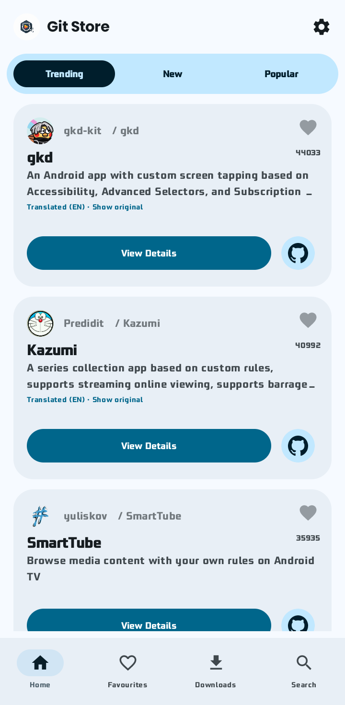
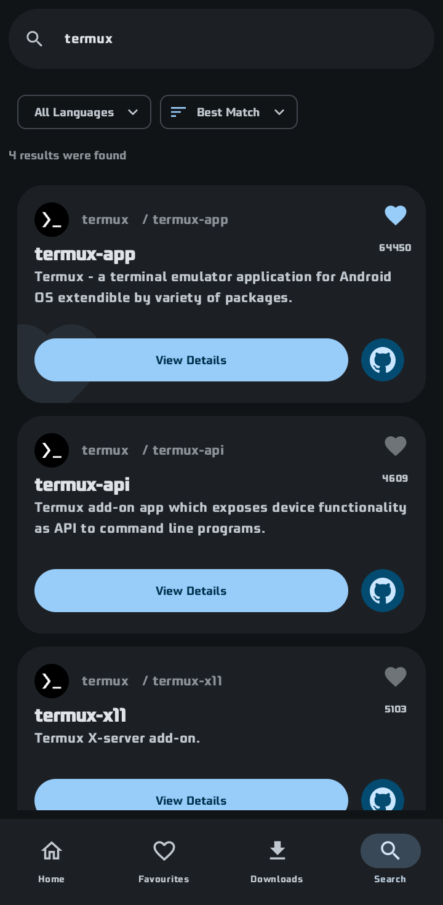
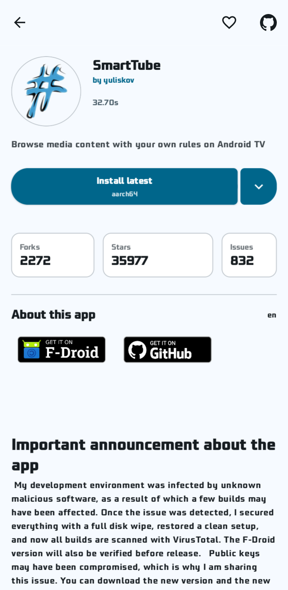
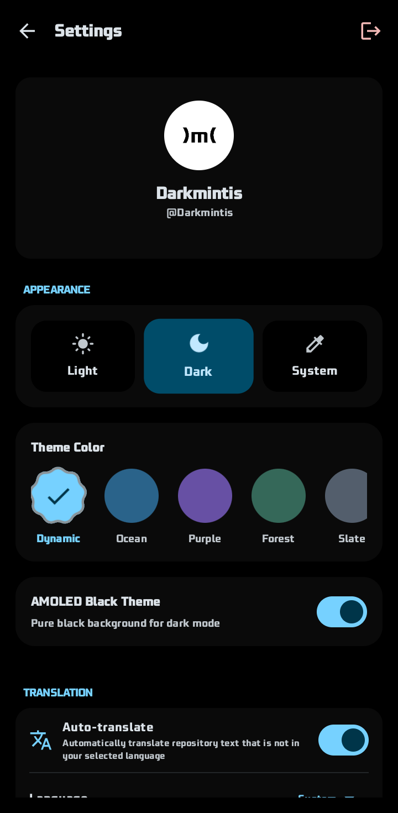

  

<h1 align="center">Git Store</h1>

  Discover, download and manage open-source Android apps published on GitHub.

  
  
  
  

---

## About

Git Store is a lightweight app store for Android apps published on GitHub. Browse trending and newly released projects, search by name or language, read READMEs and release notes, and install APKs without leaving the app.

## Screenshots

  
  
  
  

## Features

- Browse **Trending**, **New** and **Popular** GitHub repositories with Android releases
- Search, filter by language, and sort by stars, forks or best match
- Read release notes, READMEs, stats and developer profiles
- Download and install APKs with background downloads and progress notifications
- Track installed apps, check for updates, and update in bulk
- Save favourites and browse starred repositories
- GitHub sign-in via device flow for higher rate limits and starred repositories
- Offline saved lists with one-tap retry when the connection returns
- Material 3 Expressive UI, adaptive layouts, six palettes, dynamic colour and AMOLED
- Seven UI locales with on-the-fly translation of descriptions and READMEs

## Download

Download the latest APK from [Releases](https://github.com/Darkmintis/GitStore/releases/latest).

**Requirements**
- Android 7.0 (API 24) or newer
- Allow installs from unknown sources when Android prompts (Git Store is distributed via GitHub, not Google Play)

## Built with

Kotlin · Jetpack Compose (Material 3 Expressive) · Navigation 3 · Koin · Ktor · Room · DataStore · Coil 3

## Contributing

Bug reports and pull requests are welcome — see [CONTRIBUTING.md](CONTRIBUTING.md).

## Security

Please report vulnerabilities privately as described in [SECURITY.md](SECURITY.md).

## License

Apache License 2.0 — see [LICENSE](LICENSE).

## Disclaimer

Git Store is not affiliated with GitHub, Inc. APKs are downloaded from the repositories' own release assets; install them at your own risk.

---

An Android-focused app store inspired by [komi-store](https://github.com/komi-store/komi-store).
